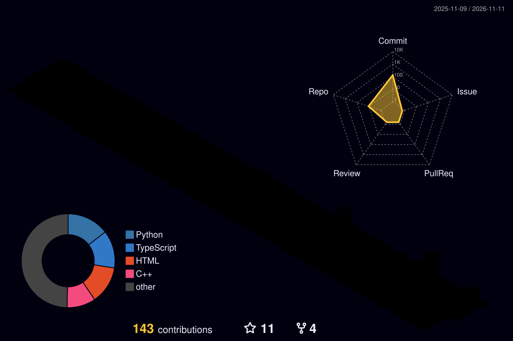

Final-Year ECE (2027) · Chennai, India · National Hackathon 360° 3.0 Winner

---

### About

I build firmware close to the metal and software close to the user.

Most recently I interned at **Harpy Aerospace**, writing CubeSat ADCS firmware: B-dot detumbling, magnetorquer control and FreeRTOS mode management, the kind of work where a single race condition can end a mission. Alongside that, I design and ship AI-assisted web platforms end to end: backend APIs, agentic pipelines and deployed products.

### Approach

I treat embedded and web work as one discipline: define the failure modes first, test against them, then ship. On spacecraft firmware that means explicit state machines, mocked hardware and unit tests before anything flies. On web platforms it means fallbacks and auditable outputs, like the rule-based fallback in EV Guardian and the traceable answers in SatQuery.

### Currently

Exploring RTOS internals and real-time systems design, building an AI-orchestrated health memory platform (Continnum), and extending a vision-language assistant for satellite imagery (SatQuery).

### Selected

> *CubeSat ADCS Firmware*: B-dot detumbling, magnetorquer PWM control and FreeRTOS state management, Unity-tested with hand-mocked drivers. 
> *Career Compass*: AI-guided college admissions platform covering all 38 TN districts, with a 200+ college database and a [live demo](https://career-compass-s6l5.onrender.com/).

| 🛰️ **Aerospace firmware** | 🏆 **Hackathon winner** | 🌐 **Full-stack AI builds** | 📡 **Real-time systems** |
|:--:|:--:|:--:|:--:|
| CubeSat ADCS FreeRTOS · STM32H7 | National Hackathon 360° 3.0 + 3 more podium finishes | 6+ shipped projects with live demos | RTOS internals Sensor fusion · CCSDS |

---

## 🧠 Tech Stack

 

<table width="100%">
<tr><td width="28%"><b>🛰️ Embedded & RTOS</b></td><td>

</td></tr>
<tr><td><b>📡 Protocols & Electronics</b></td><td>

</td></tr>
<tr><td><b>🌐 Software & Web</b></td><td>

</td></tr>
<tr><td><b>🛠️ Tools & Platforms</b></td><td>

</td></tr>
</table>

## 💼 Experience

<table width="100%">
<tr>
<td width="22%" valign="top"><b>May – Jul 2026</b> Chennai / Remote</td>
<td valign="top">

**Embedded Engineer Intern** · *Harpy Aerospace*
- Built CubeSat ADCS firmware in Embedded C on FreeRTOS: B-dot detumbling, magnetorquer PWM drive, event-group mode management (SAFE / DETUMBLING / NOMINAL)
- Debugged and unified the BMX160 IMU driver, backed by a hand-mocked Unity test suite
- Integrated sensor data pipelines with spacecraft telemetry systems

</td>
</tr>
<tr>
<td valign="top"><b>Nov – Dec 2025</b></td>
<td valign="top">

**Intern** · *Airport Authority of India*
- Analyzed X-ray scanners, CCTV and telecom infrastructure in airport security systems
- Documented detection technologies and surveillance architecture in technical reports

</td>
</tr>
<tr>
<td valign="top"><b>Dec 2024</b></td>
<td valign="top">

**In-Plant Trainee** · *Globesic Technologies*
- Embedded systems fundamentals, sensor and actuator interfacing

</td>
</tr>
</table>

## 🚀 Featured Projects

<table width="100%">
<tr>
<td width="50%" valign="top">

### 🛰️ CubeSat ADCS Firmware
B-dot detumbling, magnetorquer PWM control and FreeRTOS state management. Unity-tested with hand-mocked drivers.

`Embedded C` `STM32H7` `FreeRTOS` `Unity`

🔒 *Proprietary codebase, not public*

</td>
<td width="50%" valign="top">

### 🧭 Career Compass
AI-guided college admissions platform for 12th-graders. Covers all 38 TN districts with marks-aware recommendations and a 200+ college database.

`Node.js` `Express` `Groq (Llama 3.3 70B)`

[🔗 Live Demo](https://career-compass-s6l5.onrender.com/) · [📦 Code](https://github.com/Samdcruzzz/Career-Compass)

</td>
</tr>
<tr>
<td width="50%" valign="top">

### 🔋 EV Guardian
Predictive-maintenance dashboard for EV telemetry with Gemini-powered health scoring, root-cause diagnosis and a rule-based fallback.

`React 19` `TypeScript` `Gemini API`

[🔗 Live Demo](https://ev-guardian-h0dk5vfut-nova-minds1.vercel.app) · [📦 Code](https://github.com/Samdcruzzz/EV-Guardian)

</td>
<td width="50%" valign="top">

### 🧬 Continnum
AI-orchestrated health memory platform for elderly care. Unifies fragmented records and flags polypharmacy, cognitive decline and consent risks.

`Python` `AI Orchestration` `Health-Tech`

[📦 Code](https://github.com/Samdcruzzz/continnum)

</td>
</tr>
<tr>
<td width="50%" valign="top">

### 🌌 SatQuery
Vision-language assistant for optical and SAR satellite imagery, with agentic routing to specialist models and auditable outputs.

`Vision-Language Models` `Agentic Routing`

[📦 Code](https://github.com/Samdcruzzz/SatQuery)

</td>
<td width="50%" valign="top">

### ♻️ Paper Sage
Sensor-driven recyclable / non-recyclable paper sorter.

**🥇 National Hackathon 360° 3.0 Winner**

`Microcontroller` `Sensor Array` `Actuators`

[📦 Code](https://github.com/Samdcruzzz/Paper-Sage)

</td>
</tr>
</table>

<b>🗂️ More projects</b>

 

| Project | Description | Stack |
|:--|:--|:--|
| [**PingSense**](https://github.com/Samdcruzzz/PingSense-Orchestrate) | WhatsApp notification router with OCR, offline speech recognition and scam/prompt-injection filtering. **83.3% action accuracy.** | `Python` `pytesseract` `Anthropic API` |
| **AllCollegeEvent** | Gamified campus event platform: discover fests, earn XP, build squads, AI-powered itineraries. | `TypeScript` |
| [**Smart Light Control**](https://github.com/Samdcruzzz/Light-Intensity) | LDR + IR auto-brightness and motion-responsive lighting, deployed in a lab environment. | `Arduino` `Embedded C` `PWM` |

---

## 🏙️ Contribution Skyline

<picture>
  <source media="(prefers-color-scheme: dark)" srcset="./profile-3d-contrib/profile-night-rainbow.svg">
  <source media="(prefers-color-scheme: light)" srcset="./profile-3d-contrib/profile-season.svg">
  
</picture>

Each tower is a day of commits, PRs and issues: taller means busier.

## 🏆 Recognition

| | Award | Event |
|:--:|:--|:--|
| 🥇 | **Winner, Best Innovators** | National Level Hackathon 360° 3.0, KPR Institute of Engineering & Technology |
| 🥈 | **2nd Place** | Project Expo, Velammal Engineering College |
| 🥉 | **3rd Prize** | Shark Tank Innovation Challenge, Madras Institute of Technology |
| 🥉 | **3rd Place** | Paper Presentation, St. Joseph College of Engineering |

## 🎓 Education & Certifications

**B.E. Electronics & Communication Engineering** · Velammal Engineering College · 2023 – 2027

- Advance Diploma in Python Programming, CSC
- Cryptography & Network Security, NPTEL
- Orchestrate: Built & Deployed an AI Agent, HackerRank
- The Future of Full Stack Development, GUVI × HCL

---

## 💬 Let's Build Something

*Open to embedded, firmware and robotics opportunities.*

<a href="https://samueljoshua.netlify.app/"><code>samueljoshua.netlify.app</code></a> · <a href="https://www.linkedin.com/in/samuel-joshua-j-5491a72a9/"><code>LinkedIn</code></a> · <a href="mailto:ktmsjsam@gmail.com"><code>ktmsjsam@gmail.com</code></a>

 

